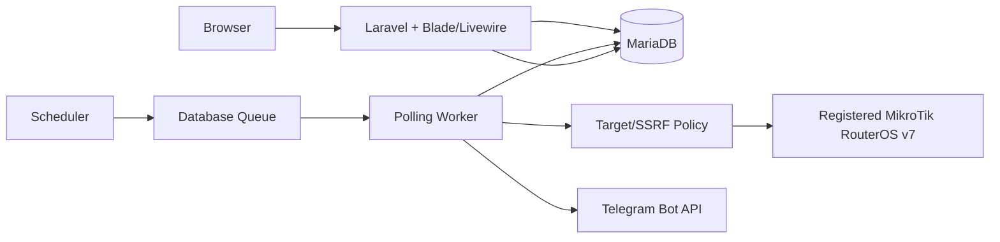

# MikroTik Control Center (MCC)
## Product Requirements Document (PRD)

**Versi:** 2.0  
**Status:** Draft terkontrol — siap untuk review keputusan terbuka  
**Tanggal:** 12 Oktober 2026  
**Backend:** Laravel  
**MVP:** Monitoring read-only RouterOS v7 melalui API-SSL  

> Dokumen ini adalah spesifikasi produk. Keputusan teknis yang belum disetujui tidak boleh dianggap sebagai izin implementasi.

---

## 1. Ringkasan Eksekutif

MikroTik Control Center (MCC) adalah aplikasi web Laravel untuk memantau hingga 10 perangkat MikroTik RouterOS v7 melalui satu dashboard terpusat. Aplikasi terinspirasi oleh kemudahan alur kerja WinBox, tetapi tidak dimaksudkan untuk menyalin seluruh antarmukanya.

MVP hanya bersifat **read-only**. MCC mengambil metrik secara berkala melalui API-SSL dengan verifikasi sertifikat wajib, menampilkan status dan histori monitoring, serta mengirim notifikasi Telegram ketika router mengalami gangguan atau kembali dapat dihubungi. Tidak ada operasi perubahan konfigurasi router pada MVP.

Lingkungan pengembangan yang disepakati adalah Docker pada lab lokal atau virtual, dengan MariaDB dan database queue. Polling berlangsung setiap 30 detik dengan maksimum 3 router dipolling bersamaan; histori disimpan selama 30 hari.

---

## 2. Latar Belakang dan Masalah

Admin jaringan membutuhkan cara terpusat untuk mengetahui kesehatan beberapa router tanpa membuka sesi WinBox satu per satu. Tanpa monitoring terpusat, gangguan koneksi, CPU/memory tinggi, perubahan status interface, dan kenaikan trafik sulit diketahui secara konsisten. Data historis juga tidak tersedia untuk analisis sederhana.

MCC menyelesaikan masalah tersebut dengan mengumpulkan data read-only, memberi timestamp dan indikator kualitas data, memisahkan kegagalan antar-router, serta menyediakan dashboard dan notifikasi yang dapat ditindaklanjuti.

---

## 3. Tujuan dan Indikator Keberhasilan

### Tujuan

1. Menyediakan dashboard terpusat untuk 10 router MikroTik.
2. Menampilkan metrik monitoring wajib dengan waktu pengambilan yang jelas.
3. Mendeteksi gangguan dan pemulihan konektivitas secara dapat diuji.
4. Memastikan kegagalan satu router tidak menghentikan monitoring router lain.
5. Menjaga batas read-only dan keamanan kredensial.

### Indikator keberhasilan MVP

| Indikator | Kriteria |
|---|---|
| Kapasitas | 10 router terdaftar; 3 polling bersamaan |
| Jadwal | Job polling dibuat pada interval 30 detik |
| Histori | Data dalam periode 30 hari tersedia; data lebih lama terhapus terjadwal |
| Isolasi kegagalan | Timeout/auth failure satu router tidak menggagalkan job router lain |
| Read-only | Tidak ada command perubahan konfigurasi yang tersedia di service MVP |
| Keamanan | Credential tidak tampil di browser/log dan tersimpan terenkripsi |
| Data freshness | Setiap metrik memiliki timestamp dan status kualitas data |
| Notifikasi | Gangguan/pemulihan Telegram mengikuti rule yang terdokumentasi |

---

## 4. Pengguna dan Use Case

### Admin

Admin dapat mengelola pengguna, perangkat, metadata perangkat, enable/disable monitoring, dan konfigurasi aplikasi yang diizinkan. Admin dapat melihat semua data monitoring dan histori.

### Operator

Operator hanya dapat melihat dashboard, status perangkat, metrik, histori, dan informasi monitoring. Operator tidak boleh melakukan operasi yang mengubah konfigurasi router atau pengaturan administratif.

### Use case utama

- Admin mendaftarkan router dan menjalankan uji konektivitas.
- Admin mengaktifkan monitoring perangkat.
- Pengguna melihat status keseluruhan dan detail router.
- Pengguna melihat histori trafik interface.
- Pengguna menerima notifikasi gangguan/pemulihan melalui Telegram.
- Admin melihat hasil/error polling untuk investigasi.

---

## 5. Ruang Lingkup MVP

### Termasuk

- Login, logout, session protection, dan role Admin/Operator.
- Pendaftaran, tampilan, perubahan metadata, enable/disable monitoring, dan penghapusan perangkat.
- Validasi target koneksi dan allowlist perangkat terdaftar.
- Polling berkala 30 detik melalui API-SSL RouterOS v7.
- Status `online`, `offline`, `unknown`, dan `stale`.
- CPU usage, memory usage, uptime, versi RouterOS.
- Status interface dan trafik RX/TX.
- Grafik histori trafik.
- DHCP lease dengan hanya informasi yang disetujui untuk kebutuhan monitoring.
- Notifikasi Telegram untuk gangguan dan pemulihan.
- Log polling, error reporting aman, audit aktivitas penting.
- Retensi histori 30 hari.

### Di luar scope

- Perubahan konfigurasi router, reboot, upgrade, write command, atau remote action.
- Wireless client monitoring, VPN/tunnel monitoring, email/SMS/WhatsApp notification.
- Multi-site permission atau pembatasan akses router per grup.
- Dukungan RouterOS v6 atau transport API plaintext.
- Dukungan vendor selain MikroTik.
- Billing, inventory aset umum, ticketing, dan topologi jaringan.

---

## 6. Persyaratan Fungsional

Setiap persyaratan memiliki prioritas: **MUST** wajib MVP, **SHOULD** penting tetapi dapat dijadwalkan setelah fungsi inti, dan **OPEN** masih membutuhkan keputusan.

### FR-001 — Autentikasi dan role (MUST)

Sistem harus menyediakan login/logout dan membedakan Admin serta Operator. Hak akses wajib diperiksa server-side pada setiap endpoint/action.

**Acceptance criteria:** pengguna valid dapat login; pengguna nonaktif ditolak; Operator tidak dapat membuka action administratif atau write operation; logout mengakhiri session; akses tidak sah menghasilkan respons terlarang tanpa membocorkan informasi.

### FR-002 — Manajemen perangkat (MUST)

Admin dapat menambah, melihat, mengubah metadata, mengaktifkan/menonaktifkan monitoring, dan menghapus perangkat. Data minimal: nama, host/IP, port API-SSL, metadata, status aktif, dan referensi credential terenkripsi.

**Acceptance criteria:** input host/port divalidasi; test connection dilakukan sebelum enable; perangkat yang tidak terdaftar tidak boleh menjadi target koneksi; perubahan penting dicatat.

### FR-003 — Validasi target koneksi/SSRF (MUST)

Server hanya boleh menghubungi perangkat yang terdaftar dan diizinkan, dengan validasi host/IP, kebijakan CIDR, perlindungan DNS rebinding, dan pencegahan akses ke target internal yang tidak diizinkan.

**Acceptance criteria:** target yang gagal policy dihentikan sebelum koneksi; validasi diterapkan di service koneksi, bukan hanya form; kegagalan dicatat tanpa credential; redirect tidak boleh melewati policy.

### FR-004 — Polling berkala (MUST)

Sistem harus menjalankan polling otomatis setiap 30 detik dengan polling independen per router dan maksimum 3 router bersamaan.

**Acceptance criteria:** router A timeout tidak membatalkan router B; overlapping job dicegah; hasil memiliki start/end time, status, dan error terstruktur; polling terakhir dan polling sukses terakhir ditampilkan.

### FR-005 — Dashboard (MUST)

Dashboard menampilkan jumlah router, jumlah berdasarkan status, CPU, memory, uptime, versi RouterOS, status interface, RX/TX, histori trafik, polling terakhir, dan keberhasilan terakhir.

**Acceptance criteria:** loading, empty, error, partial data, dan stale state memiliki tampilan jelas; dashboard tidak terblokir saat router unreachable; data menampilkan timestamp.

### FR-006 — Status perangkat (MUST)

Sistem menyediakan empat status: `unknown`, `online`, `offline`, dan `stale`. Definisi numerik final tunduk pada keputusan D-014; implementasi tidak boleh mengarang threshold yang belum disetujui.

**Acceptance criteria:** status diturunkan dari hasil polling dan timestamp; status data tidak tersedia berbeda dari nilai nol; perubahan status tercatat untuk kebutuhan notifikasi.

### FR-007 — Metrik RouterOS (MUST)

Sistem mengambil CPU, memory, uptime, versi RouterOS, interface state, RX/TX counter, dan DHCP lease sesuai capability dan permission perangkat.

**Acceptance criteria:** sumber data dan unavailable behavior didokumentasikan; metrik unsupported ditampilkan sebagai unavailable, bukan nol; tiap sampel memiliki timestamp server dan bila tersedia timestamp sumber.

### FR-008 — Histori trafik (MUST)

Sistem menyimpan sampel counter dan/atau rate yang diperlukan untuk grafik histori 30 hari, menangani counter reset, interface berubah, sampel hilang, dan timestamp tidak konsisten.

**Acceptance criteria:** counter reset tidak menghasilkan spike palsu; interface diidentifikasi stabil; grafik memberi label gap/partial data; data lebih tua dari 30 hari dihapus terjadwal tanpa menghapus data yang masih dalam retensi.

### FR-009 — DHCP lease (MUST)

Sistem menampilkan hanya informasi lease yang diperlukan untuk monitoring, dengan minimisasi data sensitif. Rincian field final harus dikonfirmasi pada keputusan D-013.

**Acceptance criteria:** data lease dapat unavailable tanpa menggagalkan metrik lain; informasi yang tidak dibutuhkan tidak dikumpulkan atau ditampilkan; akses tetap tunduk pada role.

### FR-010 — Telegram notification (MUST)

Sistem mengirim notifikasi gangguan dan pemulihan router melalui Telegram Bot, mencegah pengulangan akibat failure beruntun, mencatat kegagalan pengiriman, dan mengelola token secara aman.

**Acceptance criteria:** event dan format pesan dapat diuji; failure beruntun tidak mengirim spam; pemulihan mengacu pada definisi status yang disetujui; token tidak muncul di UI/log.

### FR-011 — Audit dan error (MUST)

Login, perubahan perangkat, perubahan monitoring, acknowledgment konfigurasi, dan error penting dicatat secara aman. Log tidak boleh berisi password/token.

### FR-012 — Retensi (MUST)

Data histori yang lebih tua dari 30 hari dihapus oleh proses terjadwal. Proses harus idempotent, terukur, dan tidak memblokir polling.

---

## 7. Persyaratan Nonfungsional

| ID | Persyaratan | Prioritas | Acceptance criteria |
|---|---|---|---|
| NFR-001 | API-SSL dengan verifikasi sertifikat | MUST | Sertifikat invalid menolak koneksi; tidak ada fallback diam-diam ke plaintext |
| NFR-002 | Credential protection | MUST | Encrypted at rest; tidak dikirim browser; masking di log |
| NFR-003 | Least privilege | MUST | Akun RouterOS hanya memiliki permission read yang diperlukan |
| NFR-004 | Fault isolation | MUST | Failure satu device tidak menghentikan queue lain |
| NFR-005 | Freshness | MUST | UI menampilkan last poll, last success, dan stale/unavailable |
| NFR-006 | Concurrency | MUST | Maksimal 3 polling aktif; overlapping device job dicegah |
| NFR-007 | Data retention | MUST | Cleanup hanya menghapus data >30 hari |
| NFR-008 | Security baseline | MUST | CSRF, validation, authorization, session protection, rate limiting |
| NFR-009 | Observability | MUST | Log polling, latency, error category, queue/scheduler health |
| NFR-010 | Testability | MUST | Unit, feature, integration, authorization, dan failure-mode test |
| NFR-011 | Operability | OPEN | Detail worker/scheduler Docker menunggu D-010 |

---

## 8. Model Ancaman Ringkas

| Ancaman | Kontrol wajib |
|---|---|
| SSRF ke jaringan internal | Registered-device allowlist, CIDR policy, DNS/IP validation, service-side enforcement |
| Credential disclosure | Encryption, secret masking, no browser exposure, least privilege |
| Operator melakukan write | Server-side policy, read-only service contract, no write command |
| Telegram token bocor | Secret store/env handling, redaction, restricted access |
| Router timeout menghabiskan resource | Connect/read timeout, bounded retry, concurrency limit |
| Data palsu karena counter reset | Counter continuity check, gap/reset marker |
| Unauthorized dashboard access | Authentication, authorization policy, CSRF, rate limiting |

---

## 9. Arsitektur Produk Tingkat Tinggi

Batas kepercayaan utama berada antara browser dan server, server dan database, serta server dan jaringan router. Browser tidak pernah menerima credential router. Worker adalah satu-satunya komponen yang boleh membuka koneksi monitoring setelah melewati policy target.

---

## 10. Milestone Produk

### M0 — Baseline dan keputusan terbuka

Finalisasi keputusan teknis prioritas tinggi: versi Laravel/PHP, CIDR, sertifikat, timeout, status, auth, dan library. **Tidak boleh masuk implementasi koneksi sebelum D-008 selesai.**

### M1 — Fondasi aplikasi

Docker lab, Laravel baru, MariaDB, database queue, auth/role, layout Blade + Livewire, dan model perangkat.

### M2 — Integrasi read-only

Service RouterOS v7 API-SSL, test connection, device polling, isolasi failure, metrik inti, dan status freshness.

### M3 — Histori dan dashboard

Counter/rate pipeline, grafik trafik, DHCP lease minimisasi, retensi 30 hari, dashboard loading/error/partial state.

### M4 — Alert, Telegram, dan hardening

Deteksi gangguan/pemulihan, deduplication, Telegram, audit log, security testing, failure-mode testing, dan dokumentasi operasional.

### M5 — Acceptance review

Seluruh acceptance criteria diverifikasi, keputusan terbuka ditutup atau dikeluarkan dari MVP, dan paket diserahkan untuk Hermes Agent.

---

## 11. Checklist Persetujuan Produk

- [ ] Definisi status dan threshold disetujui.
- [ ] Field DHCP lease disetujui.
- [ ] Rule notifikasi Telegram disetujui.
- [ ] Acceptance criteria seluruh FR disetujui.
- [ ] Keputusan teknis pada register yang berstatus terblokir telah ditutup.
- [ ] Scope read-only dan daftar out-of-scope dikonfirmasi.
